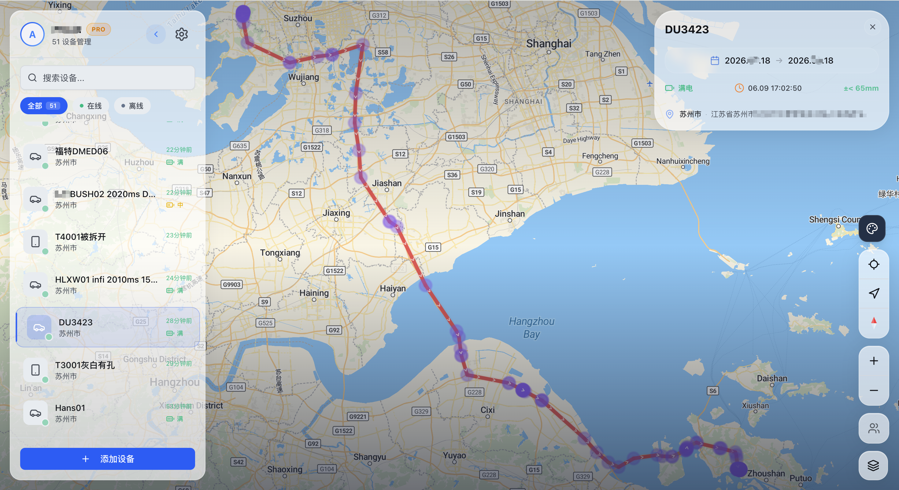
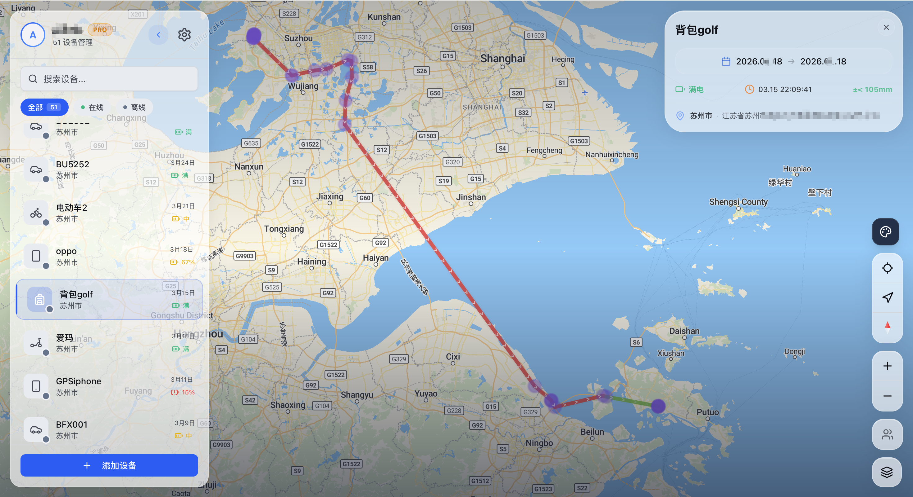
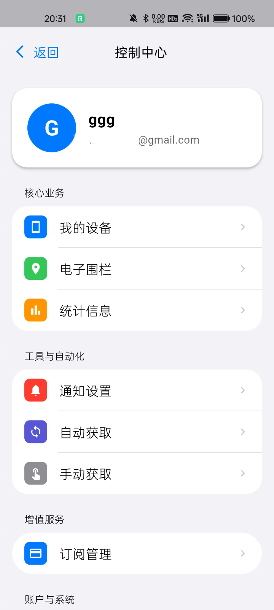
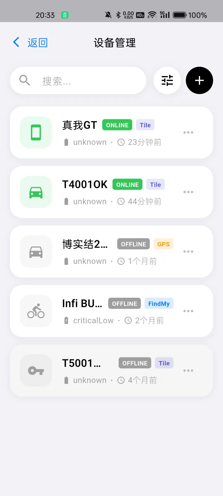
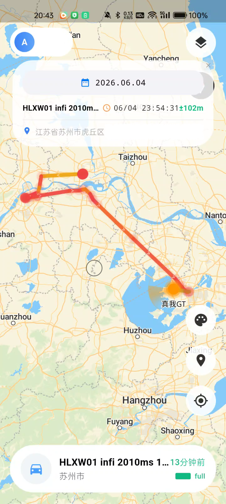
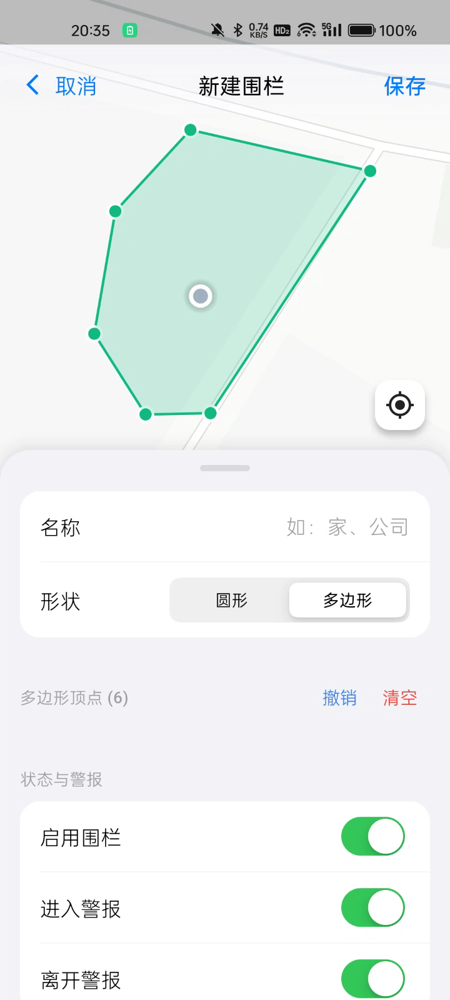

# AirTracer 🌐

[English](README_EN.md) | [日本語](README_JA.md) | [한국어](README_KO.md) | **中文**

> 📍 **真正连贯轨迹的 Apple FindMy 智能防丢追踪系统**  
> 告别传统防丢器的断连与丢点，免苹果电脑（Macless），安卓/苹果全平台通用。专为**车辆追踪、宠物防丢、老人儿童守护、贵重资产管理**量身打造。

🌐 **官方在线体验平台**：[https://airtracer.us](https://airtracer.us)

---

## ⚡ 为什么选择我们的 InfiTag 防丢器？

很多用户在购买或接触市面上的防丢器（如传统 AirTag 或各类开源方案）时，常常遇到以下痛点：
* ❌ **位置整天不更新**：明明在移动，地图上却长时间没有新位置；
* ❌ **轨迹断断续续**：中间几十公里的移动过程全部丢失，只剩下两点之间的一条“粗暴直线”；
* ❌ **被系统风控机制屏蔽**：传统防丢器上报特征明显，极易被系统策略判定为异常，**直接丢弃或隐藏绝大部分位置报告**。

**InfiTag 搭载 Tracer 独家自研追踪引擎**，彻底解决了上述问题：

| 对比维度 | 🔵 普通防丢器 / 传统开源方案 (LoopTag) | 👑 AirTracer InfiTag (推荐成品设备) |
| :--- | :--- | :--- |
| **通信机制** | **静态固定协议**：设备特征单一，固定不变。 | **Tracer 独家自研引擎**：智能适配官方网络策略，特征无感穿透。 |
| **系统风控与过滤** | ⚠️ **极易被丢点** 后台检测到同一固定特征被高频上报时，会自动触发防御机制，**直接丢弃 80% 以上的位置报告**。 | ✅ **原生免疫过滤** Tracer 自研算法智能调度通信链路，系统视为正常合规设备自然移动，**不触发任何过滤机制**。 |
| **轨迹完整度** | ❌ **大直线漂移 / 中间断点严重** 过程数据大量缺失，地图上只能强行将相隔数小时的点连成粗暴直线。 | 🎯 **丝滑还原真实道路曲线** 高频捕获有效位置信号，形成连贯、密集的运动轨迹，**真正实现车道级路径还原**。 |
| **定位实时性** | ⏳ **极低**（数小时甚至整天更新一次）。 | ⚡ **极高**（周围有设备经过即可实时更新）。 |
| **适用场景** | 仅适合找钥匙等室内静态防丢。 | **完美适用于车辆定位、宠物防丢、老人小孩防走失、户外高频追踪。** |

### 📊 真实轨迹表现对比

| 👑 InfiTag 实际轨迹（Tracer 自研引擎 · 贴合道路） | 🔵 传统防丢器实际轨迹（固定模式 · 丢点断线） |
| :---: | :---: |
|  |  |
| *密集连贯的点位，完整还原真实的道路行驶路线* | *中间点位被系统丢弃，只能两点粗暴直线相连，过程完全缺失* |

---

## 📱 核心功能与界面展示

### 1. 移动端与客户端体验 (Mobile App & Web)
全平台自适应设计，无论使用安卓、iPhone 还是平板电脑，都能获得流畅如丝的体验：

| 实时地图与设备卡片 | 统一设备管理与状态监控 |
| :---: | :---: |
|  |  |

| 速度着色历史轨迹回放 | 电子围栏进出告警 |
| :---: | :---: |
|  |  |

### 2. 核心特性一览
- 📡 **免 Mac (Macless) FindMy 追踪**：无需自备 Mac 电脑作为网关服务器，随时随地在任何手机和浏览器上查看定位。
- 🔄 **Tracer 独家自研高密算法**：高频更新、超密轨迹、防丢点优化，保障每一次行车与出行的完整行进轨迹。
- 🔔 **电子围栏与即时告警**：支持自定义地理围栏范围，离开或进入指定区域时触发系统或机器人即时推送。
- 🔋 **超长续航与状态监控**：超低功耗设计，搭配纽扣电池或大容量车载电源，续航持久，低电量主动提醒。
- 🏡 **智能家居无缝接入**：原生支持 Home Assistant（MQTT Discovery），自动生成实体，轻松联动家庭自动化场景。

---

## 🚀 小白买家 3 分钟极速上手

如果您已经购买了我们的 InfiTag 防丢器，只需以下三步即可轻松使用：

### 第一步：访问平台或下载客户端
* 🌐 **网页版直接用**：手机或电脑浏览器打开 [https://airtracer.us](https://airtracer.us)
* 🤖 **安卓手机 App**：[👉 点击下载最新版 Android APK](../../releases/latest)
* 🍎 **苹果手机（免商城，10 秒快捷安装桌面应用）**：
  1. 使用 Safari 浏览器打开 [https://airtracer.us](https://airtracer.us)；
  2. 点击屏幕底部的 **【分享】** 按钮（带向上箭头的方框 📤）；
  3. 滑动选择 **【添加到主屏幕】**，即可像 App 一样全屏使用。

### 第二步：注册并绑定设备
1. 在平台点击 **【注册】**，填写用户名与密码并登录；
2. 按照设备包装内的引导，联系客服或管理员提供您的用户名，系统将一键为您名下完成设备极速绑定；
3. 刷新页面，您的防丢器便已实时出现在地图中央！

### 第三步：开始使用与日常查看
* **看实时位置**：点击底部设备卡片，地图瞬间自动对焦；
* **查历史轨迹**：点击卡片上的【📅 日历】，选择日期并点击【确认】，即可查看连贯的行车/移动路线；
* **配安全围栏**：设置家或学校为围栏，一旦离开即刻告警。

📖 **需要更详细的手把手图文指南？**
* 👉 **[InfiTag 新手图文详细手册](docs/infitag_user_guide.md)**（推荐：详细讲解轨迹查询技巧、无轨迹自查清单）
* 👉 **[小白保姆级教程总览](docs/beginner_tutorial.md)**

---

## 💎 Tracer 商业版与企业私有化定制

如果您是**车队管理公司、物流运输企业、共享设备运营商、外贸跨境电商或硬件厂商**，希望拥有自主可控的专属追踪管理平台，我们提供成熟的企业级解决方案 **Tracer**：

### 🌟 企业级核心优势
1. 🏢 **企业级云原生私有化部署**
   * 标准化容器交付：支持一键部署到企业私有云或本地机房环境（支持主流容器化编排架构）。
   * 数据完全私有闭环、自主可控，充分满足企业合规与隐私安全要求。
2. 📈 **海量时序轨迹高并发引擎**
   * 专为数万台设备同时在线的高频并发场景深度优化，毫秒级时序轨迹检索与平滑渲染。
3. 🏷️ **独立品牌 OEM 贴牌定制**
   * 全套品牌定制：定制专属企业 Logo、品牌配色、独立域名、定制移动端客户端名称及专享地图授权。
4. 👥 **多租户与组织权限体系 (RBAC)**
   * 支持集团/子公司/车队分级管理，灵活分配调度员、管理员及普通成员权限，业务彼此隔离。
5. 🛠️ **专属硬件与量产方案落地**
   * 提供从硬件方案选型、结构/PCB 设计、极致低功耗调优到固件定制的一站式量产服务（支持极具性价比的量产级 SoC 方案）。

---

### 📞 商务洽谈与定制合作

我们欢迎各类商业合作、批量采购与定制需求。联系方式：

* 📧 **商务邮箱**：[airtagtracer@gmail.com](mailto:airtagtracer@gmail.com)
* 💬 **官方 Telegram**：[@AirTracer](https://t.me/AirTracer)
* 📱 **微信商务咨询**：请扫描下方微信二维码添加技术与商务支持（添加时请备注：*AirTracer 业务合作*）

  

*来信或咨询时，建议简要说明您的业务场景（如：车队监控、宠物项圈量产、私有化部署、OEM 贴牌等），我们将在 24 小时内为您提供针对性的解决方案。*
