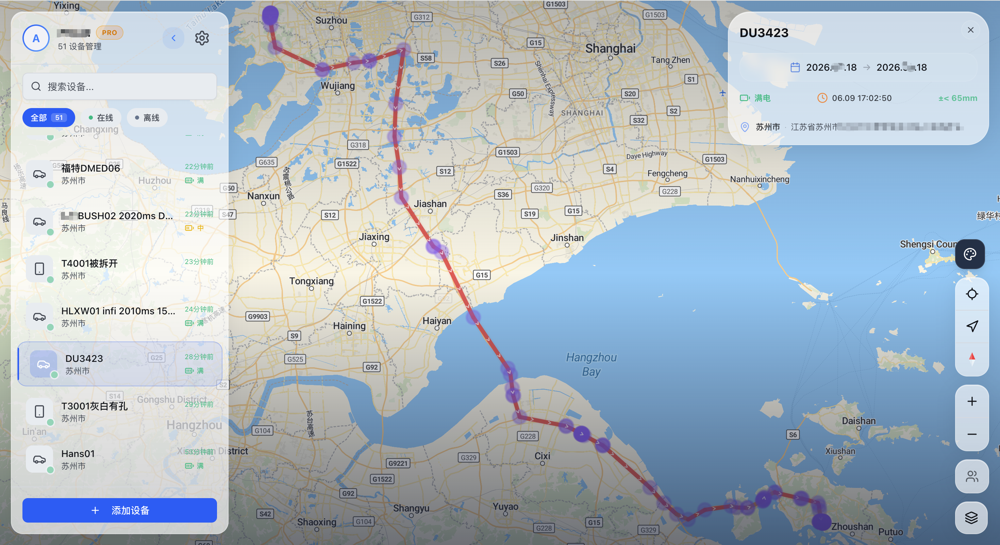
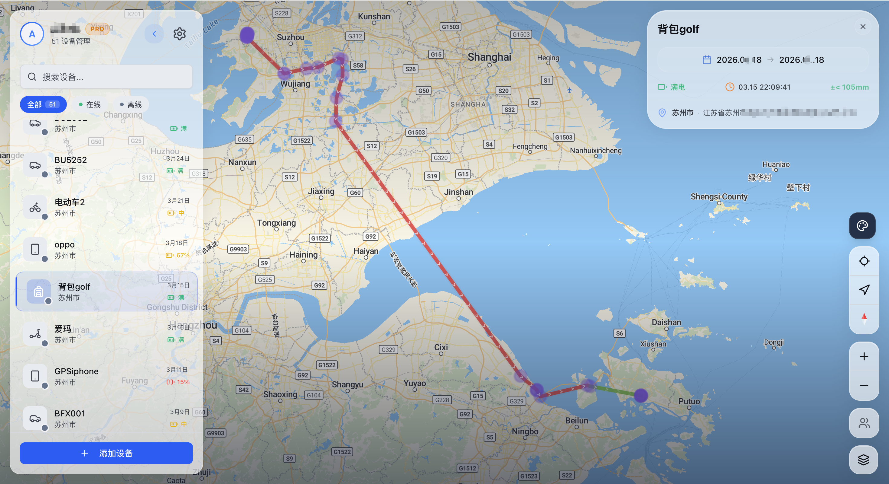
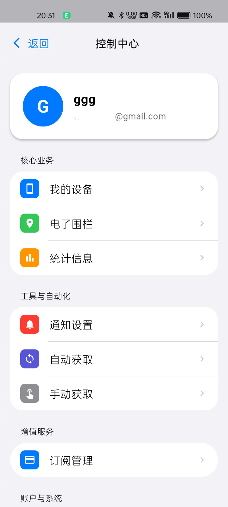
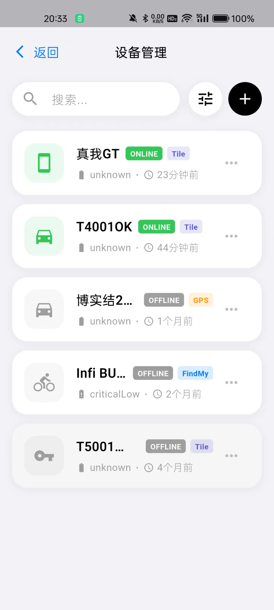
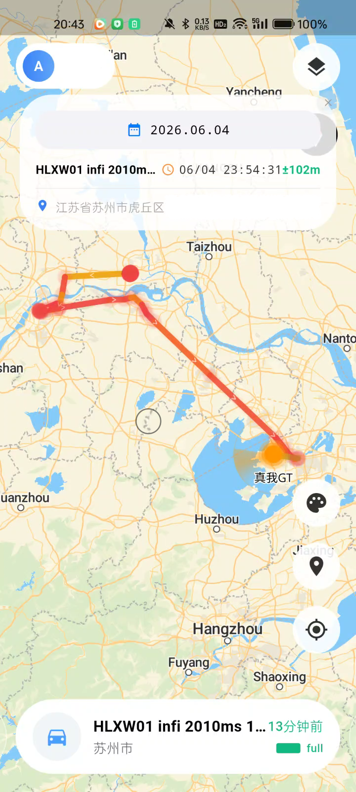
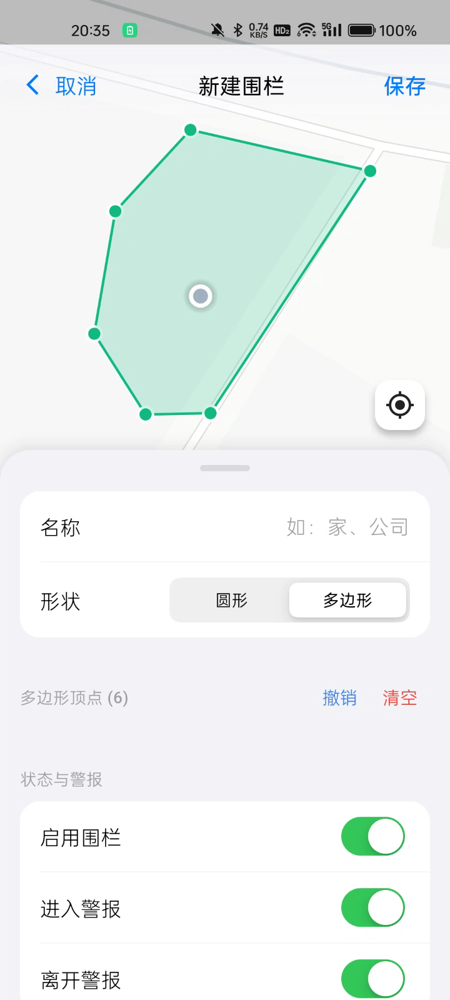

# AirTracer 🌐

**English** | [日本語](README_JA.md) | [한국어](README_KO.md) | [中文](README.md)

> 📍 **Truly Continuous Apple FindMy Smart Tracking & Anti-Loss System**  
> Say goodbye to location loss and broken lines. Macless architecture, cross-platform support for Android, iOS, and Web. Designed specifically for **vehicle tracking, pet recovery, elder/child safety, and high-value asset monitoring**.

🌐 **Official Live Platform**: [https://airtracer.us](https://airtracer.us)

---

## ⚡ Why Choose Our InfiTag Anti-Loss Tracker?

Many users face major frustrations when using standard AirTags or traditional open-source FindMy beacons:
* ❌ **Infrequent Location Updates**: Devices can move for hours without reporting an updated location.
* ❌ **Broken Trajectories**: The path is reduced to a single coarse straight line bridging distant timestamps.
* ❌ **Suppressed by System Filters**: Traditional static beacons have obvious transmission patterns, triggering system anti-stalking policies that **drop or suppress over 80% of reports**.

**InfiTag is powered by our proprietary Tracer Tracking Engine**, solving these issues from the ground up:

| Dimension | 🔵 Standard Beacons / Open-Source (LoopTag) | 👑 AirTracer InfiTag (Recommended Device) |
| :--- | :--- | :--- |
| **Protocol Design** | **Static Fixed Protocol**: Identifiers remain static and easily detected. | **Tracer Engine**: Intelligently adapts to official network policies with seamless transmission. |
| **System Filtering** | ⚠️ **Heavy Location Loss** System filters trigger on static broadcast patterns, **dropping over 80% of location reports**. | ✅ **Fully Immune** Tracer proprietary adaptive communication allows reports to be processed naturally with **zero filtering penalty**. |
| **Trajectory Quality** | ❌ **Coarse Straight Lines / Large Gaps** Missing points force straight-line approximations across huge gaps. | 🎯 **Smooth, Lane-Level Road Curves** Captures high-density coordinates to create continuous, uninterrupted travel paths. |
| **Update Latency** | ⏳ **Very Low** (Once every few hours or worse). | ⚡ **High-Frequency** (Real-time updates whenever nearby devices pass by). |
| **Best Used For** | Indoor keys or static item location. | **Vehicles, pets, seniors, children, outdoor continuous tracking.** |

### 📊 Real Trajectory Comparison

| 👑 InfiTag Path (Tracer Engine · Follows Road) | 🔵 Traditional Path (Static Mode · Dropped Points) |
| :---: | :---: |
|  |  |
| *Dense, continuous coordinates restoring authentic road travel* | *Intermediate points dropped by system; forced straight-line connection* |

---

## 📱 User Experience & Features

### 1. Cross-Platform Experience (Mobile & Web)
Seamless, adaptive interface across Android, iOS, and desktop browsers:

| Mobile Live Map & Cards | Device Management & Status |
| :---: | :---: |
|  |  |

| Speed-Colored Track Playback | Geofence Alerts |
| :---: | :---: |
|  |  |

### 2. Key Highlights
- 📡 **Macless FindMy Architecture**: Direct integration with Apple FindMy network via smart proxy scheduling—no Mac mini or gateway required.
- 🔄 **Tracer High-Density Engine**: High-density trajectory points, ultra-low latency, and intelligent path smoothing.
- 🔔 **Instant Geofencing & Push Notifications**: Set boundary limits with immediate alerts via Telegram bot or push notifications.
- 🔋 **Extended Battery Life & Health Monitoring**: Ultra-low power consumption with low-battery warnings.
- 🏡 **Smart Home Native (Home Assistant)**: Full MQTT Discovery support to automatically create sensors and device trackers.

---

## 🚀 3-Minute Quick Start for Device Owners

If you have purchased an InfiTag tracker, get started in 3 simple steps:

### Step 1: Access Platform or Download App
* 🌐 **Web Access**: Open [https://airtracer.us](https://airtracer.us) on any browser.
* 🤖 **Android Users**: [👉 Download Latest Android APK](../../releases/latest)
* 🍎 **iOS / iPhone Users (10-Second PWA Installation)**:
  1. Open [https://airtracer.us](https://airtracer.us) in Safari;
  2. Tap the **Share** button (box with an upward arrow 📤);
  3. Tap **Add to Home Screen** to install as a full-screen app.

### Step 2: Register & Bind Your Device
1. Click **Register** on the platform, choose your username and password, then sign in;
2. Provide your registered username to customer support as instructed in your packaging;
3. Refresh the page to see your tracker active on the map!

### Step 3: Track & Review
* **Real-time Map**: Tap the device card to instantly center on its location.
* **History Playback**: Tap the **Calendar** icon, pick your date range, and click **Confirm** to view path history.
* **Geofence Protection**: Define safe zones to receive instant alerts upon exit.

---

## 💎 Tracer Enterprise Solution & Commercial Customization

For **fleet management, logistics operators, shared mobility services, cross-border e-commerce brands, and hardware OEMs**, we offer the private enterprise solution **Tracer**:

### 🌟 Enterprise Capabilities
1. 🏢 **Cloud-Native Private On-Premises Deployment**
   * Turnkey containerized delivery: Deploy to private clouds or local infrastructure (compatible with major orchestration platforms).
   * 100% data ownership, compliance, and enterprise privacy guarantee.
2. 📈 **High-Concurrency Time-Series Trajectory Engine**
   * Engineered for tens of thousands of active devices with sub-second path retrieval and rendering.
3. 🏷️ **White-Label & OEM Customization**
   * Custom branding, custom domain, themed UI, dedicated mobile app branding, and proprietary map credentials.
4. 👥 **Multi-Tenant & Role-Based Access Control (RBAC)**
   * Multi-level organization hierarchy (fleet managers, dispatchers, end users) with isolated data boundaries.
5. 🛠️ **Hardware & Firmware Mass Production Support**
   * End-to-end hardware development, PCB layout, low-power optimization, and support for cost-effective mass-production SoCs.

---

### 📞 Contact & Partnership

We welcome inquiries regarding commercial deployment, bulk orders, and OEM customization:

* 📧 **Business Email**: [airtagtracer@gmail.com](mailto:airtagtracer@gmail.com)
* 💬 **Telegram**: [@AirTracer](https://t.me/AirTracer)
* 📱 **WeChat**: Scan the QR code below (Please note: *AirTracer Partnership*)

  

*Please provide a brief description of your use case when contacting us. We will respond within 24 hours.*
